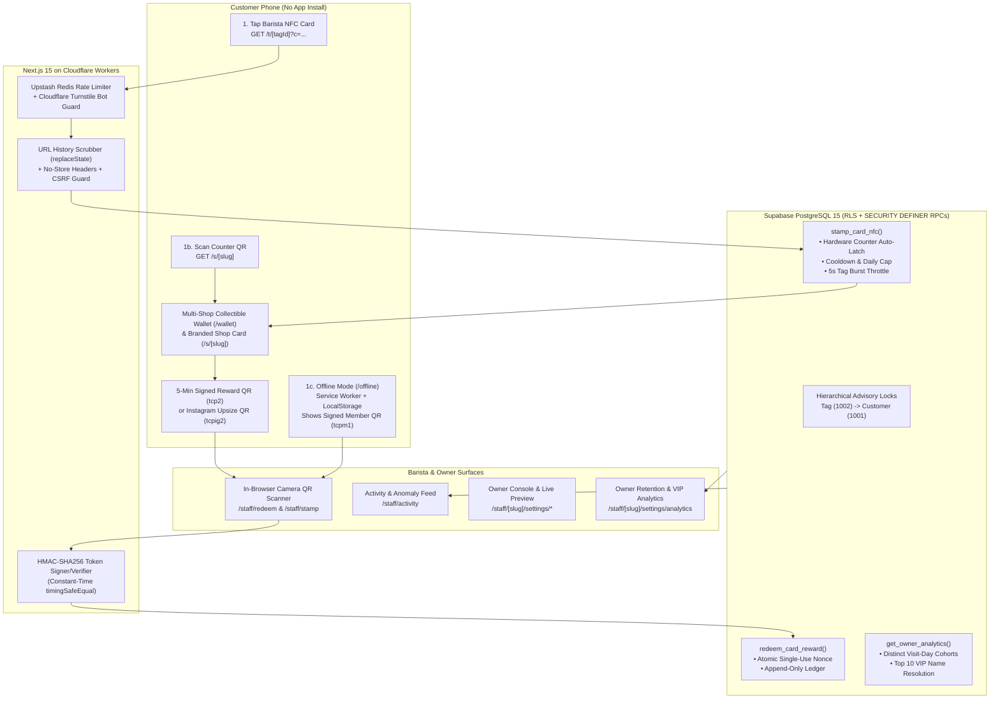

# ODYSSEY Digital Loyalty Platform — System Architecture, Retention Mechanics & Business Owner Pitch Playbook

> **Document Purpose:**
> 1. **System Analysis:** A complete technical and operational breakdown of how the Digital Loyalty Card platform works from tap to redemption, fraud prevention, offline fallback, and owner analytics.
> 2. **Retention & ROI Mechanics:** How the system measurably increases repeat visits, customer lifetime value (LTV), social growth, and profit margins for cafes, restaurants, and retail businesses.
> 3. **Business Owner Pitch Playbook:** Copy-paste outreach scripts, in-person live demo flows, pricing framing, and objection-handling templates to pitch and onboard new merchant clients.

---

# Part 1: How the System Works (End-to-End Analysis)

## 1. Executive Summary

**ODYSSEY Digital Loyalty** (originally piloted with **The Caffeine Plug**) is a multi-tenant, mobile-first **NFC & QR digital stamp card platform** built for physical businesses (specialty coffee shops, bakeries, milk tea shops, barbershops, salons, and casual dining).

Unlike traditional loyalty apps that require customers to download an app from the App Store/Google Play or fill out lengthy sign-up forms while holding up the cashier line, **ODYSSEY works in under 2 seconds in the customer's mobile browser**:
- **Zero app downloads** and **zero sign-up walls** on the first visit.
- **Physical NFC Tap** at the counter (or **Offline Member QR Scan** when a customer has no internet or NFC).
- **Bank-grade anti-fraud & anti-"sweethearting" protection** enforced inside PostgreSQL transactions.
- **Real-time Owner Retention Analytics** showing 14-day/30-day repeat rates, customer health buckets, monthly cohorts, and the Top 10 VIP customers by name.

---

## 2. High-Level System Architecture



### Core Technology Stack
- **Application & Edge Runtime:** Next.js 15 (App Router, React 19, TypeScript `strict`, Tailwind CSS) compiled via OpenNext (`@opennextjs/cloudflare`) for global edge deployment on **Cloudflare Workers**.
- **Database & Auth:** **Supabase** (PostgreSQL 15, Anonymous Auth + Google OAuth + Email Magic Links + TOTP MFA `aal2` for platform admins, Row Level Security, and `pg_cron` automated maintenance).
- **Edge Protection:** **Upstash Redis** for sliding-window rate limiting and **Cloudflare Turnstile** for invisible CAPTCHA verification during session creation and staff sign-in.

---

## 3. The Five Core Workflows

### 3.1 Customer Onboarding & Stamp Collection (`GET /t/[tagId]`)
1. **The Tap:** The customer buys a drink and taps the barista's physical **NXP NTAG215** card (or counter tag) with their phone.
2. **Instant Anonymous Wallet:** If the customer has never used the system before, the app creates an anonymous Supabase session in the background (protected by Cloudflare Turnstile) and awards their first stamp immediately upon tapping **"Get My Card"**.
3. **Returning Customer Tap:** If the customer already holds the shop's card, `GET /t/[tagId]` invokes the PostgreSQL RPC `stamp_card_nfc()` on the server and redirects (`303 See Other`) to `/s/[slug]?result=stamped` in under 2 seconds.
4. **Shop-Bound Security:** The shop (`tenant_id`) and branch (`location_id`) are resolved strictly from the `tags` table in PostgreSQL — never from client request parameters.

### 3.2 Offline Fallback & Member Stamp QR (`tcpm1` + `/offline`)
What if a customer has **zero mobile data** inside the shop, or an older phone without a working NFC antenna?
1. **Local Card Caching:** Every time a customer views their card online (`components/card/MemberStampQrPanel.tsx`), a snapshot of their card and a cryptographically signed **Member Stamp Token** (`tcpm1.<payload>.<signature>`) is cached in `localStorage` (`tcp_offline_cards_v1`).
2. **Service Worker Offline Shell (`/sw.js` & `/offline`):** If the customer opens their browser with no internet connection, the Service Worker intercepts the failed navigation and serves `/offline`, rendering their cached card and scannable Member QR code.
3. **1-Second Barista Camera Scan (`/staff/stamp`):** The barista opens `/staff/stamp`, scans the customer's Member QR using the built-in camera scanner (`QrCameraScanner`), taps a 1-click reason pill (e.g., *"Customer offline / no signal"*), and records the stamp via `stamp_card_manual()`. All cooldowns and daily caps still apply.

### 3.3 Reward Redemption & Social Perks (`tcp2` & `tcpig2`)
1. **Free Drink / Reward Redemption (`tcp2`):**
   - Once `available_stamps >= reward_threshold` (e.g., 10 stamps), the customer taps **Claim Reward** on `/s/[slug]`.
   - The server mints a 5-minute (`300s`) HMAC-SHA256 signed token (`tcp2.<payload>.<sig>`) and renders it as an offline server-side SVG QR code with an 8-character human-readable verification code (`XXXX-XXXX`).
   - The barista opens `/staff/redeem` (which launches the camera scanner directly), scans the QR, verifies the customer's balance, and confirms redemption.
   - `redeem_card_reward()` atomically verifies and burns the token's single-use `nonce` inside `public.audit_log` (`audit_log_redeem_nonce_uidx`) and inserts an immutable row into `public.redemptions`. Screenshots of old QR codes are rejected immediately.
2. **Staff-Verified Instagram Follow Upsize (`tcpig2`):**
   - Shops can enable a built-in social growth perk: *"Follow `@shophandle` on Instagram for a Free Upsize"*.
   - The customer opens the shop's Instagram profile from their card, follows, and taps **Claim Upsize** to generate a `tcpig2` QR token (domain-separated so it can never be used as a free-drink token).
   - The barista scans the QR on `/staff/redeem`, glances at the customer's phone to confirm "Following", and grants the one-time upsize (`claim_card_perk()`) without spending any stamps.

### 3.4 Account Backup, Cross-Device Recovery & Collectible Wallet (`/wallet`)
- **Collectible Multi-Shop Wallet (`/wallet` & `/wallets`):** Customers hold a single login across the entire ODYSSEY network, with a distinct, custom-branded card for every participating shop they visit.
- **1-Tap Backup:** Customers can link their anonymous wallet to **Google** or **Email** at any time (`BackupCardPanel.tsx` / `WalletBackupModal.tsx`). Once linked, their Google display name appears on their card and in the owner's Top 10 VIP leaderboard.
- **Deadlock-Free Wallet Merge (`merge_wallets`):** If a customer starts a new anonymous card on a new phone and then signs into their existing backed-up Google/Email account, the server verifies a cryptographic `tcp_merge1` intent cookie and atomically merges both wallets in PostgreSQL — combining stamps, redemptions, and perks while locking UUIDs in canonical ascending order (`least` → `greatest`) to prevent deadlocks.

### 3.5 Multi-Tenant Owner Console & Retention Analytics (`/staff/[slug]/settings/*`)
Each shop has a dedicated management console with role-based access control (`owner` > `manager` > `staff`):
- **Analytics Tab (`Owner` only):** Real-time retention pulse, customer health breakdown, card completion funnel, monthly first-to-second visit cohorts, and Top 10 Loyal Customers by name (`public.get_owner_analytics`).
- **Rules Tab (`Owner` saves, `Manager` previews):** Customize Reward Threshold (`3–50` stamps), Reward Label (e.g., `FREE COFFEE`), Cooldown (`0–1440` mins), Daily Cap (`1–20` stamps/day), and Tag Throttle (`0–60` secs). Includes a **Live Customer Impact Preview** showing how many existing cardholders would immediately qualify for a reward before saving.
- **Brand Tab (`Manager+`):** Customize Primary Card Color, Accent Color (with automatic WCAG AA contrast validation and fallback), Shop Tagline, Stamp Icon (`coffee`, `star`, `cup`, `heart`, `bolt`, `paw`, `leaf`, `scissors`, `utensils`, `sparkles`), Logo, and Card Art.
- **Branches Tab (`Owner` only):** Manage multiple physical branch locations sharing a single brand card (with branch-level tag & stamp tracking), or permanently separate a branch into its own independent shop (`separate_branch_into_tenant`).
- **Tags Tab (`Manager+`):** Provision NFC tags per branch, view live **Hardware Counter Latch status** (`Counter Latch Active (#20)` vs `Static URL`), monitor **Tag-Leak Warnings**, and rotate compromised tags in one click.
- **Plan & Billing (`/staff/billing`):** Transparent per-active-customer metering with an interactive cost simulator (*"What if I had N active customers?"*).

---

## 4. Deep Dive: Multi-Layer Security & Anti-Fraud Architecture

Business owners often worry about two types of loyalty fraud: **customer replay fraud** (copying a tag link or screenshotting a QR code) and **employee "sweethearting"** (baristas tapping their own card for friends or spamming manual stamps). ODYSSEY blocks both across four layers:

| Threat Vector | How ODYSSEY Stops It | Where It Lives in Code / DB |
| :--- | :--- | :--- |
| **Customer copies or bookmarks the NFC tap URL** | 1. **Hardware Counter Auto-Latch:** Supports NTAG215 ASCII counter (`?c=`) and UID+counter (`?m=`) mirroring. Once latched, any tap with a counter $\le \text{last\_tap\_counter}$ is rejected and logged as `stamp_rejected_counter_replay`.<br>2. **Browser History Scrubbing:** `Cache-Control: no-store`, `Referrer-Policy: no-referrer`, `window.history.replaceState()`, and `router.replace()` strip `?t=`, `?c=`, and `?m=` immediately so the tap URL never stays in browser history. | [`app/t/[tagId]/route.ts`](file:///g:/Projects/Digital-Loyalty-Card/app/t/%5BtagId%5D/route.ts), [`lib/nfc/verifyTap.ts`](file:///g:/Projects/Digital-Loyalty-Card/lib/nfc/verifyTap.ts), `stamp_card_nfc()` |
| **Customer taps 10 times in a row at the counter** | **3-Rule Database Gate:**<br>• **Tag Burst Throttle:** Blocks taps on the same physical tag within `tag_throttle_seconds` (default 5s).<br>• **Customer Cooldown:** Blocks a second stamp for the same customer within `cooldown_minutes` (default 30m).<br>• **Daily Cap:** Blocks stamps beyond `daily_cap` (default 2/day) in the shop's timezone (`Asia/Manila`). | `stamp_card_nfc()` in `supabase/migrations/20261107020000_nfc_anti_replay_and_audit.sql` |
| **Simultaneous double-tap race condition** | **Hierarchical Transaction Advisory Locks:** Every stamp and redemption acquires PostgreSQL `pg_advisory_xact_lock` on `tag (1002)` then `customer (1001)`, serializing concurrent requests cleanly without table locks. | `stamp_card_nfc()`, `redeem_card_reward()` |
| **Customer screenshots a "Free Coffee" QR code to use twice** | **5-Minute TTL + Atomic Single-Use Nonce:** Reward tokens (`tcp2`) expire in 300 seconds and embed a random 128-bit `nonce`. `redeem_card_reward()` inserts the nonce into a unique partial index (`audit_log_redeem_nonce_uidx`) inside the customer lock. A second scan fails with `already-claimed`. | [`lib/security/redeemToken.ts`](file:///g:/Projects/Digital-Loyalty-Card/lib/security/redeemToken.ts), `redeem_card_reward()` |
| **Barista "Sweethearting" (giving free stamps to friends)** | **Automated Behavioral Anomaly Flags on `/staff/activity`:**<br>• **Cooldown-Hugging:** Flags customers who repeatedly tap right after the cooldown window expires ($\text{cooldown} \le \Delta t \le \text{cooldown} + 15\text{m}$).<br>• **Buddy-Tag Concentration:** Flags when a customer repeatedly triggers caps/blocks on one specific barista's named NFC card.<br>• **Frequent Manual Overrides:** Flags any customer receiving $\ge 3$ manual stamps, with mandatory staff attribution and reason logging. | [`lib/auth/staff.ts`](file:///g:/Projects/Digital-Loyalty-Card/lib/auth/staff.ts), [`app/staff/activity/page.tsx`](file:///g:/Projects/Digital-Loyalty-Card/app/staff/activity/page.tsx) |
| **Lost or photographed NFC card** | **Tag-Leak Detection & 1-Click Rotation:** Alerts managers with a yellow banner if a tag sees $>8$ distinct customers in 15 minutes or $>25$ throttle/replay rejections in 1 hour. Clicking **Rotate** kills the old URL immediately and issues a new tag ID. | [`lib/ops/tag-leak.ts`](file:///g:/Projects/Digital-Loyalty-Card/lib/ops/tag-leak.ts), `rotate_tag_at()` |
| **Cross-shop tampering or direct DB writes** | **Append-Only Ledger + RLS + ESLint Guard:** Customers have zero `INSERT`/`UPDATE`/`DELETE` privileges on `stamps` or `redemptions`. Balances are computed dynamically from the append-only ledger (`card_balances` view). ESLint bans `admin.from(...)` in server code so all privileged writes must go through audited `SECURITY DEFINER` RPCs. | `supabase/migrations/20261105000000_phase12_contract.sql`, `.eslintrc.json` |

---

# Part 2: How ODYSSEY Improves Customer Retention & Business Revenue

When pitching to a business owner, avoid leading with database terminology. Lead with **customer psychology, repeat visit math, and operational speed**.

## 1. Solving the 5 Biggest Leaks in Traditional Loyalty Programs

### Leak #1: The "Download Our App" Wall (85% Drop-Off)
- **The Problem:** Customers standing at a cash register with coffee in hand will not download a 60MB app, create a password, verify an email, and type their birthday just to get 1 stamp.
- **How ODYSSEY Fixes It:** The barista taps the NFC card to the customer's phone. The browser opens their card in **under 2 seconds**. No app store, no form, no password. Onboarding conversion jumps from <15% to **70–90% of counter transactions**.

### Leak #2: Lost, Washed, and Forgotten Paper Cards
- **The Problem:** Customers lose paper stamp cards, put them through the laundry, or leave them in another bag. When a customer loses a paper card with 6 stamps on it, the psychological momentum resets to zero — and they lose their reason to choose your shop over a competitor.
- **How ODYSSEY Fixes It:** Their phone is always in their hand. With 1-tap **Google or Email Backup**, even if they buy a new phone or clear their browser, their stamps are safely recovered and merged automatically.

### Leak #3: Paper Stamp Fraud & Barista "Sweethearting"
- **The Problem:** Anyone can buy a ₹100 / ₱150 rubber stamp online, or a friendly staff member can punch 5 extra holes on a friend's paper card when the owner isn't looking. A shop giving away 3 unverified free drinks a day at ₱150 each loses **₱13,500/month** in retail value.
- **How ODYSSEY Fixes It:** Every stamp requires a cryptographic NFC tap or an audited staff scan, bounded by a 30-minute cooldown and 2-stamp daily cap. Every manual stamp logs the exact barista and reason, and automatic anomaly flags alert the owner to suspicious patterns.

### Leak #4: Flying Blind (Zero Data on Who Actually Returns)
- **The Problem:** With paper cards (or basic POS systems where walk-ins pay cash/GCash without giving a name), the owner has no idea:
  - What percentage of first-time customers ever come back for a second visit?
  - How many days pass between visits?
  - How many regulars are slipping away (`At-Risk` 15–30 days without visiting)?
  - Who are the shop's Top 10 most loyal regulars?
- **How ODYSSEY Fixes It:** The **Owner Analytics Dashboard** (`/staff/[slug]/settings/analytics`) computes all of this automatically in the shop's timezone:
  - **14-Day & 30-Day First-to-Second Visit Repeat Rate** (counting distinct visit days so a 2-drink order on Day 1 doesn't fake a repeat visit).
  - **Retention Health Bar:** Splits all members into *Active Regulars*, *New (1st Visit)*, *At-Risk (15–30d)*, and *Dormant (30d+)*.
  - **Top 10 VIP Leaderboard:** Shows the actual names of top backed-up regulars, their lifetime stamps, rewards claimed, and last visit date so owners and baristas can greet VIPs by name.

### Leak #5: Paying High Fixed SaaS Fees on Slow Months
- **The Problem:** Many SaaS loyalty tools charge $50–$150/month (₱3,000–₱8,500/month) regardless of whether the shop is small, seasonal, or just starting out — or charge per total registered user even if 80% haven't visited in months.
- **How ODYSSEY Fixes It:** **Active-Customer Metering.** Holding a card in a wallet is **₱0 (100% free)**. A shop is only metered when a customer actually walks in and earns at least one stamp that calendar month, with plans starting at ₱0 base fee (₱10/active customer) or capped at ₱1,200/month max.

---

## 2. Behavioral Psychology Built Into the Card UI

1. **The Goal-Gradient Effect (Accelerating Visit Cadence):**
   Consumer psychology research (Kivetz, Urminsky & Zheng, Columbia/Chicago) proves that customers accelerate their purchase frequency the closer they visually get to a reward. ODYSSEY's high-contrast stamp grid, halfway milestone markers, and live `"X more stamps to FREE COFFEE"` counter keep the goal salient on every tap.
2. **Post-Redemption Loop (`2nd-Card Return Rate`):**
   Immediately after a customer redeems their 10th stamp, their card resets cleanly for the next cycle while the `/wallet` records their **Completed Cards** badge count — turning a single reward into a multi-card status game.
3. **Zero-Cost Customer Acquisition via Instagram Upsize:**
   Instead of spending thousands of pesos on cold social ads, every customer card features a built-in **"Follow us on Instagram for a Free Upsize"** claim flow. Customers follow the shop right at the counter, and baristas verify it in 2 seconds with a cryptographic QR scan.

---

## 3. ROI & Unit Economics Calculator (Example for a Local Café)

Use this simple table when showing a shop owner how the system pays for itself many times over:

| Metric | Without ODYSSEY (Paper / None) | With ODYSSEY Digital Loyalty | Monthly Impact |
| :--- | :--- | :--- | :--- |
| **New walk-in customers / month** | 200 | 200 | — |
| **Loyalty enrollment rate** | ~15% (30 paper cards kept) | ~75% (150 digital cards tapped) | **+120 tracked customers/mo** |
| **30-day repeat visit conversion** | ~20% | ~35% (+22 retained regulars) | **+22 repeat customers/mo** |
| **Extra visits per retained regular** | — | +3 extra visits / month | **+66 incremental visits/mo** |
| **Average order value (AOV)** | ₱180 | ₱180 | **+₱11,880 new monthly revenue** |
| **Saved from stamp fraud / sweethearting** | ~15 unverified drinks/mo lost | Blocked by cooldowns & nonces | **+₱2,700 saved/mo** |
| **Platform Cost (Starter 50 / Growth 200)** | ₱500+ (reprinting paper cards) | ₱350 – ₱1,200 / month | **10x–30x Net ROI** |

---

# Part 3: Business Owner Pitching Templates & Sales Playbook

Below are ready-to-use scripts and templates tailored for different outreach channels. Replace bracketed placeholders like `[Owner Name]`, `[Shop Name]`, and `[Your Name]` before sending.

---

## Template 1: The 60-Second In-Person Counter Pitch (Highest Conversion)

> **Best used when:** Visiting a café, bakery, milk tea shop, or barbershop during non-peak hours (e.g., 9:30–11:00 AM or 2:00–4:00 PM). Bring one programmed NTAG215 demo card in your pocket.

**Step 1 — The Hook (15 seconds):**
> *"Hi `[Owner Name]`, love the vibe here at `[Shop Name]`. Quick question — are you guys still using paper stamp cards right now, or do you have a way to track how many first-time customers actually come back within 30 days?"*

**Step 2 — The Live Tap Demo (20 seconds):**
> *(Pull out your physical NFC demo card)*
> *"Let me show you something in 2 seconds. Hold your phone near this card — no app to download, no sign-up form."*
> *(Tap the card to the top of their iPhone or center-back of their Android. Their browser opens the branded card and stamps it immediately.)*
> *"That's it. In two seconds, your customer has a custom-branded `[Shop Name]` stamp card in their phone, and you just recorded their visit."*

**Step 3 — The Business Value (25 seconds):**
> *"Three reasons coffee shops are switching to this from paper cards:*
> *1. **Customers never lose it**, and there's no app download holding up your register line.*
> *2. **Zero stamp fraud** — it automatically enforces a 30-minute cooldown and daily limit, plus single-use 5-minute QR codes for free drinks so nobody can screenshot a reward or over-stamp their friends.*
> *3. **You get a live Owner Retention Dashboard** on your phone showing your exact 14-day and 30-day repeat visit rate, which regulars haven't visited in 2 weeks, and your Top 10 VIP customers by name.*
>
> *We can set up a custom `[Shop Name]` card with your logo and colors for a free trial this week. Want me to mock up your card so you can see how it looks?"*

---

## Template 2: Instagram DM / Facebook Messenger Outreach (Short & Visual)

> **Best used when:** Messaging local specialty coffee shops, cafes, or lifestyle brands on Instagram/Facebook where owners check DMs daily.

### Message 1 (Initial Opener — Do not pitch a wall of text)
```text
Hey [Shop Name] team! 👋 Loved your [mention a specific drink/post, e.g., Spanish Latte / new branch setup].

Quick question for the owner — are you currently using paper stamp cards for regulars, or do you already have a digital tap card at the counter?

We built a 2-second NFC tap loyalty card (originally for The Caffeine Plug) that works right in the customer's phone browser with zero app download, plus a built-in "Follow us on IG for a Free Upsize" verifier.

Would love to send over a 30-second video of how it works if you're open to it! ☕
```

### Message 2 (After they reply "Sure, send it over" or "How does it work?")
```text
Awesome! Here’s how it works at the counter:

1️⃣ Barista taps a physical NFC card to the customer's phone -> Their branded [Shop Name] stamp card opens in 2 seconds and adds a stamp (no app download, no sign-up form).
2️⃣ Even if a customer has zero signal/data inside the shop, their card shows an Offline Member QR your barista can scan in 1 second.
3️⃣ Built-in IG growth: Customers can tap "Follow @[their_ig_handle] for a Free Upsize" right on the card, and your barista scans a single-use QR to verify.
4️⃣ Owner Retention Dashboard: You see your exact 14-day & 30-day repeat customer rate, who is slipping away, and your Top 10 most loyal regulars by name.

Best part: holding a card is ₱0. You only pay a few pesos for active customers who actually visit that month (capped so your bill never surprises you), and you can test it on a free trial first.

If you send me your logo and brand hex colors, I can spin up a live [Shop Name] preview card for you to tap today! 🙌
```

---

## Template 3: Cold / Warm Email to Café & Multi-Branch Business Owners

> **Subject Line Options:**
> - `2-second NFC stamp card for [Shop Name] (no app download)`
> - `Turning [Shop Name]'s first-time walk-ins into tracked 30-day regulars`
> - `How The Caffeine Plug replaced paper stamp cards + automated retention tracking`

```markdown
Hi [Owner Name],

I’ve been following [Shop Name] and wanted to reach out with something built specifically for independent cafes and multi-branch F&B brands here in the Philippines.

Most coffee shops face a tough trade-off with customer loyalty:
- **Paper stamp cards** get lost, washed, or abused (staff over-stamping friends), and give you zero data on whether first-time customers actually return.
- **Traditional loyalty apps** require customers to download an app and fill out a form at the cash register — so 85% of customers say "next time" and never join.

We built **ODYSSEY Digital Loyalty** (currently powering *The Caffeine Plug*) to give you the speed of a physical card with the intelligence of a full retention platform:

- **2-Second NFC Tap (Zero App Install):** Your barista taps an NFC card to the customer's phone. Their branded [Shop Name] card opens instantly in their mobile browser and records the stamp.
- **Works Offline:** If a customer has no mobile data inside your shop, their card automatically displays an Offline Member QR your barista can scan in 1 second.
- **Built-In Anti-Fraud & Anti-"Sweethearting":** The system automatically enforces your cooldown (e.g., 30 mins between stamps) and daily cap (e.g., 2 stamps/day), uses 5-minute single-use QR codes for reward redemptions, and flags unusual manual stamping or rapid taps automatically.
- **Owner Retention & VIP Analytics:** See your 14-day and 30-day repeat visit rates, how many regulars are "At-Risk" (15–30 days away), branch-by-branch performance, and your **Top 10 VIP customers by name**.
- **Built-In Instagram Follower Booster:** Optional one-time perk where customers follow `@[Shop IG Handle]` to unlock a barista-verified Free Upsize.

**Fair, Active-Customer Pricing:**
You never pay for inactive sign-ups. Holding a card is free—you only pay ₱5–₱10 per *active customer* who actually earns a stamp that month (with a Worry-Free Cap option that never exceeds ₱1,200/month no matter how busy you get).

I’d love to set up a customized `[Shop Name]` card with your logo and colors so you can test it on your phone this week—completely free during your trial.

Are you free for a quick 10-minute coffee or call this [Thursday or Friday]?

Best regards,

**[Your Name]**
[Your Title / ODYSSEY Digital Loyalty]
[Your Phone / WhatsApp / Viber]
[Link to Live Demo / Website]
```

---

## Template 4: 5-Minute Discovery & Live Demo Script (In-Person or Zoom)

When sitting down with an owner, follow this exact **5-step sequence**:

### 1. Diagnose Their Current Baseline (1 Minute)
Ask these 3 questions:
1. *"When a brand-new customer buys a drink today, how do you bring them back for a second visit within 2 weeks?"*
2. *"Out of 100 first-time customers this month, do you know how many came back a second time?"* (99% of owners will say *"No idea."*)
3. *"If you use paper cards, how do you make sure staff aren't giving 4 stamps at once to their friends, or customers aren't losing their cards?"*

### 2. Show the Customer Experience (1.5 Minutes)
- Tap the physical NFC card to the owner's phone (or have them scan the demo QR).
- Point out:
  - *"Notice how fast that was? Zero app store, zero typing an email while holding up the line."*
  - *"Look at your custom colors, logo, and stamp icons."*
  - *"Now tap the card a second time right now."* → Show them the **`COOLDOWN ACTIVE`** banner. *"See that? Your barista doesn't even have to play bad cop. The system enforces your 30-minute cooldown and 2-stamp daily cap automatically."*
  - Toggle airplane mode or tap **"Show Member QR"** → *"And if a customer has zero cell signal in your shop, their card still shows this signed Member QR that your barista scans in 1 second."*

### 3. Show the Barista Redemption Flow (1 Minute)
- Open `/staff/redeem` on your phone/tablet.
- Tap **Claim Reward** on the customer card to reveal the 5-minute QR code.
- Scan it with the in-browser camera scanner on `/staff/redeem`.
- Point out: *"It verifies in 1 second, deducts the 10 stamps, and permanently burns that QR code so a screenshot can never be reused."*

### 4. The "Aha!" Moment — Show the Owner Analytics Screen (1 Minute)
- Open `/staff/[slug]/settings/analytics` (`OwnerAnalyticsDashboard`).
- Point to the 4 sections:
  1. **Headline Pulse:** *"Here is your real 30-day and 14-day repeat rate, plus the median days between visits."*
  2. **Retention Health Bar:** *"Here you can see how many customers are Active Regulars vs. At-Risk (haven't visited in 15–30 days)."*
  3. **Card Completion Funnel:** *"You can see exactly how many people are halfway to a free drink, and what % of customers come back for a 2nd card after redeeming their first free coffee."*
  4. **Top 10 Loyal Customers:** *"And right here are your Top 10 VIP customers by name, lifetime stamps, and last visit date."*

### 5. Show the Pricing Simulator & Close for the Free Trial (30 Seconds)
- Open `/staff/billing` and type `100` into **"If I had ___ active customers"**.
- *"If a customer holds your card and doesn't visit this month, you pay ₱0. You only pay for active customers who actually earn a stamp that month. On Starter 50, 50 active regulars is just ₱350/month — that's the price of two cups of coffee. And with our Worry-Free Cap, your bill is capped at ₱1,200/month even if 500 regulars visit."*
- **The Close:** *"Let's launch your shop on a free trial this week. Send me your logo and tell me how many stamps you want for a free reward, and I'll deliver your programmed NFC cards ready for the counter."*

---

## Template 5: Objection-Handling Cheat Sheet

### Objection 1: *"We already have paper stamp cards and they're cheap to print."*
> **Response:**
> *"Paper cards are cheap to print, but they cost you in three hidden ways:*
> *1. Half your customers lose them or forget them at home, which breaks their habit of coming back.*
> *2. You have zero protection against a staff member stamping 5 holes for a friend—just 2 extra free drinks a week costs you ₱1,500+/month, which is more than our entire platform cap.*
> *3. Paper cards give you zero data. You can't see your 30-day repeat rate or who your Top 10 VIPs are. With ODYSSEY, you get all of that for less than the cost of 1 cup of coffee a week."*

### Objection 2: *"My customers won't want to download an app or give their personal info."*
> **Response:**
> *"100% agree—that's why there is NO app download and NO sign-up form. When they tap the card at the counter, it opens directly in Safari or Chrome in 2 seconds using an anonymous pass. They only link their Google account or email later if they choose to back up their stamps. Plus, it's fully compliant with the Philippines Data Privacy Act (RA 10173)."*

### Objection 3: *"What if the customer doesn't have mobile data inside my shop, or uses an old phone without NFC?"*
> **Response:**
> *"We built a dedicated Offline Mode for that exact situation. Every customer's card automatically caches a signed Member QR code on their phone—even with zero internet connection. Your barista just scans that QR with the shop phone/tablet camera in 1 second to give them their stamp."*

### Objection 4: *"Does this require integrating with our POS / cash register?"*
> **Response:**
> *"Zero POS integration required. It runs completely alongside any POS—even if you use a tablet, a traditional register, or cash/GCash. Your barista just taps the physical NFC card to the customer's phone when handing over the drink, and uses any phone or tablet at the counter to scan reward QR codes when someone hits 10 stamps."*

### Objection 5: *"What if my staff just keep tapping the NFC card for their friends?"*
> **Response:**
> *"Great question—we built an Anti-Sweethearting engine specifically for shop owners:*
> *First, each physical NFC card can be named after the barista or register (e.g., 'Register 1' or 'Barista Mark').*
> *Second, the database strictly blocks any customer from getting a second stamp within 30 minutes or more than 2 stamps a day.*
> *Third, our Activity screen automatically flags 'Cooldown-Hugging' (people tapping right at the 31-minute mark), 'Buddy-Tag Concentration' (the same person always tapping one barista's card), and manual stamp overrides."*

### Objection 6: *"What if someone copies the NFC card link or shares it in a group chat?"*
> **Response:**
> *"Two protections stop that cold: First, the card uses hardware tap-counter latching alongside instant URL history scrubbing so the link never stays in their browser history. Second, if a tag ever gets abnormal traffic (like >8 people in 15 minutes), your console shows a yellow leak alert and lets you rotate and kill that tag in one click."*

### Objection 7: *"I don't want another high monthly subscription if we have a slow month."*
> **Response:**
> *"That's why we don't charge a flat ₱5,000 SaaS fee. On Pay-As-You-Go, your base fee is ₱0—you literally only pay ₱10 for a customer who actively walks in and earns a stamp that month. As you grow, Starter 50 is ₱350/month, and our Worry-Free Cap means you will never pay more than ₱1,200/month even if you have 1,000 active regulars."*

---

## Template 6: Post-Meeting Follow-Up & Onboarding Checklist Message

> **Send via WhatsApp / Viber / Email within 2 hours of a successful demo:**

```text
Hi [Owner Name]! Great chatting with you today at [Shop Name]. 🙌

As promised, I’m setting up your free trial workspace on ODYSSEY Digital Loyalty so you and your team can test it live.

To customize your card today, just reply with:
1. Your Shop Logo (PNG or JPG)
2. Your preferred Card Background Color & Stamp Color (or I can match your logo!)
3. Your Reward Rule (Default is: 10 stamps = 1 FREE COFFEE, max 2 stamps/day, 30-min cooldown — let me know if you want to customize this)
4. Your Instagram handle (if you want to turn on the "Follow us for a Free Upsize" perk)
5. The email address you want to use for your Owner Console login

Once you send those over, I’ll have your live [Shop Name] card and programmed NFC counter tags ready in 24 hours! ☕🚀
```
