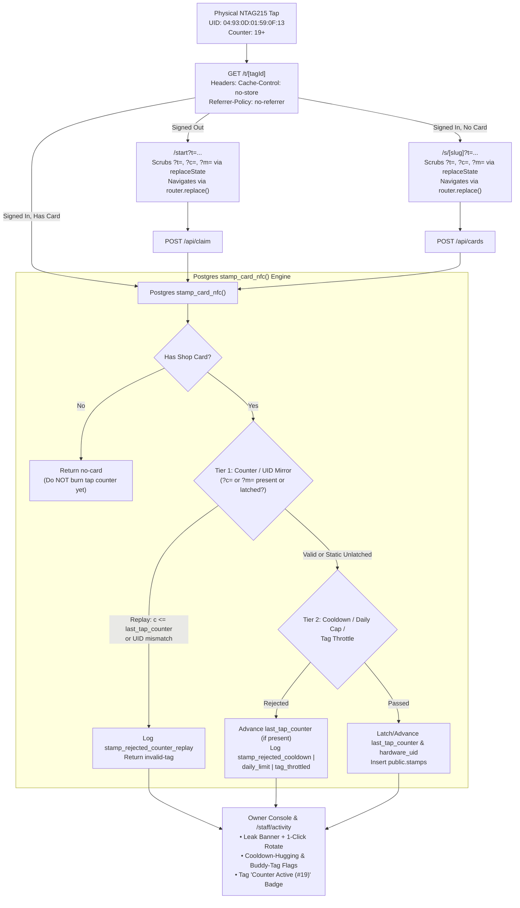

# NFC Anti-Replay & Anti-Sweethearting Security Plan (Tailored to Your NTAG215 Card)

## 1. Hardware Diagnostic Summary (From Your NFC Tools Scan)

| Property | Value on Your Card | Security & Implementation Impact |
| :--- | :--- | :--- |
| **Chip Type** | `NXP - NTAG215` (ISO 14443-3A, Type 2, 540B / 135 pages) | Standard 4-byte page layout (`0x00`–`0x86`); config registers at pages `0x83`–`0x84` (131–132). |
| **Serial Number (UID)** | `04:93:0D:01:59:0F:13` (`04930D01590F13`) | 7-byte factory UID (14 hex chars); can be mirrored alongside the tap counter (`?m=`). |
| **Signature** | `Invalid` | Indicates a 3rd-party NTAG215-compatible clone IC. Some clone ICs support full NDEF ASCII Mirror; others only increment the counter register on `READ_CNT`. Our design handles **both** seamlessly. |
| **NFC Counter** | `19` (Active & counting) | The hardware counter is already enabled and non-zero (`19`). Our database **must auto-latch onto whatever counter number the card is already at** (e.g. `20`), never assuming a new tag starts at `0`. |
| **Writable / Password** | `Writable: Yes`, `Protected by password: No` | **Immediate physical risk:** Anyone with NFC Tools can overwrite the card URL. Must be write-protected using **NFC Tools → Other → Set password** (never permanent "Lock"). |

---

## 2. Two-Tier Defense Architecture

Because your card is a 3rd-party NTAG215 (`Signature: Invalid`) with an active counter (`NFC Counter: 19`), we will implement a **Two-Tier Defense** that automatically uses hardware counter verification if the chip mirrors it into the URL, and enforces full software anti-replay and anti-sweethearting regardless:

---

## 3. Implementation Tasks

### Task 1: Browser History Scrubbing & HTTP Redirect Hardening (Software Anti-Replay)
Guarantees that even if the card runs in plain static URL mode (`/t/[tagId]`), the tag URL is never stored in browser history or leaked via headers.

- **[`app/t/[tagId]/route.ts`](file:///c:/dev/DigitalLoyalty/app/t/[tagId]/route.ts)**
  - Attach `Cache-Control: no-store, no-cache, must-revalidate` and `Referrer-Policy: no-referrer` to every response from `/t/[tagId]`.
  - Forward optional `?c=` / `?m=` counter mirror query params across the `303` redirect to `/start` or `/s/[slug]` when a customer is signed out or doesn't hold the shop's card yet.
- **[`app/start/page.tsx`](file:///c:/dev/DigitalLoyalty/app/start/page.tsx)** & **[`app/s/[slug]/page.tsx`](file:///c:/dev/DigitalLoyalty/app/s/[slug]/page.tsx)**
  - Extract optional `c` / `m` search parameters and pass `tapCounter` (or raw mirror param) to [`GetCardButton`](file:///c:/dev/DigitalLoyalty/components/card/GetCardButton.tsx) and [`AddCardPanel`](file:///c:/dev/DigitalLoyalty/components/card/AddCardPanel.tsx).
- **[`components/card/GetCardButton.tsx`](file:///c:/dev/DigitalLoyalty/components/card/GetCardButton.tsx)** & **[`components/card/AddCardPanel.tsx`](file:///c:/dev/DigitalLoyalty/components/card/AddCardPanel.tsx)**
  - On mount (`useEffect`), immediately strip `t`, `c`, and `m` from `window.location` using `window.history.replaceState(null, '', cleanUrl)` while keeping the values in memory for the claim `POST`.
  - Replace `router.push(...)` with `router.replace(...)` on completion so pressing **Back** on the phone never returns to the onboarding/claim URL.

---

### Task 2: NTAG215 Counter & UID Mirror Parser (`?c=` and `?m=`)
Support both mirror formats produced by **NXP TagWriter** and **NFC Tools** on 135-page NTAG215 cards:
1. **Counter-only mirror (`?c=000013`):** 6 ASCII hex digits representing the 24-bit counter (`19` decimal = `000013` hex).
2. **UID + Counter mirror (`?m=04930D01590F13x000013`):** 14 ASCII hex digits (`04:93:0D:01:59:0F:13` without colons) + delimiter `x` (or `X`) + 6 ASCII hex digits.

- **[`lib/contracts.ts`](file:///c:/dev/DigitalLoyalty/lib/contracts.ts)**
  - Extend `VerifyTapResult` (valid branch) with `tapCounter?: number | null` and `hardwareUid?: string | null`.
  - Extend `TagRow` with `last_tap_counter?: number | null` and `hardware_uid?: string | null`.
- **[`lib/nfc/verifyTap.ts`](file:///c:/dev/DigitalLoyalty/lib/nfc/verifyTap.ts)**
  - Parse `input.query?.c` and `input.query?.m`.
  - If neither is present, return `mode: 'ntag215-static'`, `tapCounter: null`, `hardwareUid: null`.
  - If present and valid hex, return `tapCounter: parseInt(counterHex, 16)` (`0`..`16777215`) and normalized uppercase `hardwareUid` (if `m` was used).
  - If `c` or `m` is present with non-hex or wrong length, return `{ valid: false, reason: 'malformed-tag-id' }` so tampered URLs fail fast.
- **[`app/api/claim/route.ts`](file:///c:/dev/DigitalLoyalty/app/api/claim/route.ts)** & **[`app/api/cards/route.ts`](file:///c:/dev/DigitalLoyalty/app/api/cards/route.ts)**
  - Accept optional `tapCounter` / `c` / `m` in the JSON body, validate via `verifyTap`, and pass `p_tap_counter` and `p_hardware_uid` to `stamp_card_nfc`.

---

### Task 3: Database Migration — Non-Zero Counter Auto-Latch & Rejection Audit Logging
> [!IMPORTANT]
> Because your physical card's counter is already at `19` (and NTAG215 counters can never be reset to `0`), our SQL function will **auto-latch onto whatever counter value the card sends on its first mirrored tap** (e.g., `20`), and then require every subsequent tap to be strictly greater (`> 20`). When you rotate a tag (`rotate_tag_at`), the new tag row starts with `last_tap_counter = NULL` so the physical card seamlessly re-latches at its current counter on the next tap.

- **New Migration: `supabase/migrations/20261107020000_nfc_anti_replay_and_audit.sql`**
  1. **Expand `public.tags`:**
     - `last_tap_counter bigint null check (last_tap_counter is null or (last_tap_counter >= 0 and last_tap_counter <= 16777215))`
     - `hardware_uid text null check (hardware_uid is null or hardware_uid ~ '^[0-9A-F]{14}$')`
  2. **Upgrade `public.stamp_card_nfc`:**
     - Signature: `stamp_card_nfc(p_customer uuid, p_tag text, p_now timestamptz default null, p_tap_counter bigint default null, p_hardware_uid text default null)` (backward-compatible defaults).
     - **Order of evaluation:**
       1. Lock tag (`1002`) then customer (`1001`).
       2. Load tag (`tenant_id`, `location_id`, `last_tap_counter`, `hardware_uid`) and tenant settings.
       3. Check tenant status (`trial` / `active`).
       4. **Check `customer_cards` existence (`no-card`) BEFORE consuming the tap counter:** If the customer doesn't have the card yet, return `no-card` without advancing `last_tap_counter` so the immediate follow-up claim from `/start` or `AddCardPanel` with that same tap's counter succeeds.
       5. **Enforce Counter & UID Latch:**
          - If `t.hardware_uid is not null` and (`p_hardware_uid is null` or `upper(p_hardware_uid) <> t.hardware_uid`): log `stamp_rejected_counter_replay` in `public.audit_log` and return `invalid-tag`.
          - If `t.last_tap_counter is not null` and (`p_tap_counter is null` or `p_tap_counter <= t.last_tap_counter`): log `stamp_rejected_counter_replay` in `public.audit_log` and return `invalid-tag`.
          - If `p_tap_counter is not null` (valid new counter $> \text{last\_tap\_counter}$ or first latch): update `public.tags set last_tap_counter = p_tap_counter, hardware_uid = coalesce(hardware_uid, upper(p_hardware_uid))` so even a tap rejected by cooldown/daily-limit still advances the physical counter.
       6. **Enforce Cooldown, Daily Cap, and Tag Throttle — and log rejections to `public.audit_log`:**
          - Cooldown block $\rightarrow$ insert `audit_log` (`action = 'stamp_rejected_cooldown'`, `target = p_customer::text`, `detail = jsonb_build_object('tag_id', v_tag)`), return `'cooldown'`.
          - Daily cap block $\rightarrow$ insert `audit_log` (`action = 'stamp_rejected_daily_limit'`, `target = p_customer::text`, `detail = jsonb_build_object('tag_id', v_tag)`), return `'daily-limit'`.
          - Tag throttle block $\rightarrow$ insert `audit_log` (`action = 'stamp_rejected_tag_throttled'`, `target = v_tag`, `detail = jsonb_build_object('customer_id', p_customer)`), return `'tag-throttled'`.
       7. Insert stamp into `public.stamps` and return `'stamped'`.
  3. **Update `public.tag_leak_signals`:**
     - Include `'stamp_rejected_counter_replay'` in `tag_rejections` so replay attempts from browser history or shared links surface in the Console leak detector.

---

### Task 4: Anti-"Sweethearting" Anomaly Detection & NTAG215 Console Setup Guide
Catch staff tapping friends ("sweethearting") and show live hardware counter status + write-protection instructions in the Console.

- **[`lib/contracts.ts`](file:///c:/dev/DigitalLoyalty/lib/contracts.ts)** & **[`lib/auth/staff.ts`](file:///c:/dev/DigitalLoyalty/lib/auth/staff.ts)**
  - Add anomaly categories `'cooldown-hugging'` and `'buddy-tag-concentration'`:
    - **Cooldown-Hugging (`cooldown-hugging`):** Flags customers who collect multiple same-day NFC stamps spaced right after `cooldownMinutes` expires ($\text{cooldownMinutes} \le \Delta t \le \text{cooldownMinutes} + 15\text{ min}$), catching both friend hangouts and timed static-link replays.
    - **Buddy-Tag Concentration (`buddy-tag-concentration`):** Flags when a customer repeatedly hits daily caps or cooldown blocks on a single named NFC card (e.g., `Barista - Mark`), surfacing the tag's human-readable `label`.
- **[`app/staff/activity/page.tsx`](file:///c:/dev/DigitalLoyalty/app/staff/activity/page.tsx)**
  - Show the tag's `label` (e.g., `Barista - Mark`) next to `tag_id` in the Recent Stamps table.
- **[`components/console/ConsoleTagsManager.tsx`](file:///c:/dev/DigitalLoyalty/components/console/ConsoleTagsManager.tsx)** & **[`app/staff/[slug]/settings/tags/page.tsx`](file:///c:/dev/DigitalLoyalty/app/staff/[slug]/settings/tags/page.tsx)**
  - Show a status pill on each tag: **`Counter Latch Active (#19)`** (when `last_tap_counter !== null`) vs **`Static URL`** so you can immediately verify whether your NTAG215 card's counter mirror is working after tapping it once.
  - Add an expandable **"NTAG215 Security & Setup Guide"** panel in the Tags manager with:
    1. **Password Write-Protection (Fixes `Writable: Yes`):** Step-by-step for **NFC Tools → Other → Set password** (and warning never to use permanent "Lock").
    2. **Staff Attribution:** Naming 1 card per barista.
    3. **Optional Counter Mirror URL:** Copy button for the NXP TagWriter mirror template.

---

## 4. Verification Gate
- **pgTAP Database Tests (`supabase/tests/`):**
  - Non-zero initial counter auto-latch (`p_tap_counter = 20` latches at `20`; replay of `20` or `19` or `NULL` fails and logs `stamp_rejected_counter_replay`; `21` succeeds).
  - `no-card` tap with `p_tap_counter = 20` does not burn counter `20` before the user completes `add_card` / `claim`.
  - Cooldown, daily-limit, and tag-throttle rejections write to `public.audit_log` and feed `tag_leak_signals`.
- **Unit Tests (`tests/unit/`):**
  - `verifyTap` tests for static, `?c=000013`, `?m=04930D01590F13x000013`, and malformed inputs.
  - `detectActivityAnomalies` tests for `cooldown-hugging` and `buddy-tag-concentration`.
  - Browser history scrubbing (`replaceState` + `router.replace`) tests.
- **Full Gate:** `npx supabase db reset && npx supabase test db && npm run lint && npm run typecheck && npm run test:unit`.
